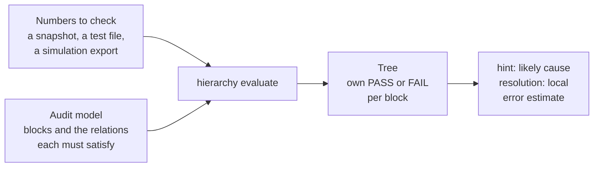

# PhysicsGuard

<p align="center">
  
</p>

<p align="center"><strong>Your AI does physics in its head, and it is confidently wrong about units, signs and balances. PhysicsGuard checks the numbers against the balances they must satisfy, says which block is wrong, and how small an error the check could have seen.</strong></p>

| Version | Runtime | Package | License |
| --- | --- | --- | --- |
| `v0.16.0` | Python 3.11+ | `physicsguard` | MIT |

[中文说明](./README.zh-CN.md)

PhysicsGuard is a Python tool and an agent skill (Claude Code, Codex). It turns a calculation, a simulation result or a
test file into a small audit: blocks, the physical relations each block must satisfy (mass and energy balances, unit
conversions, gains, maps), and the values to check. The tool, not the AI, evaluates every relation and prints one
verdict per block.

## 30 seconds: the shower mix

A user asks: *6 L/min of water is heated from 15 °C to 60 °C and then mixed with 9 L/min of water at 15 °C. What heater
power is needed, and how warm is the water at the shower?*

**Without PhysicsGuard**, the AI answers with confidence:

> Heater power: 0.1 kg/s × 4186 J/(kg·K) × 45 K = **18,837 W**.
> Outlet temperature: (60 + 15) / 2 = **37.5 °C**.

The power is right. The temperature is wrong: the AI averaged the two temperatures and ignored that the cold stream is
larger. The energy balance gives (0.1 × 60 + 0.15 × 15) / 0.25 = **33.0 °C**.

**With PhysicsGuard**, the AI writes its numbers into a snapshot and checks them against a two-block audit (an inline
heater and a mixing tee). Both files ship in `examples/hierarchical/shower_mix/`:

```console
$ python -m physicsguard.cli hierarchy evaluate examples/hierarchical/shower_mix/audit.yaml examples/hierarchical/shower_mix/observed_ai.yaml
audit shower_mix on ai_answer: FAIL; 4 checked, 0 unchecked, 2 derived; mapping 8 rows, 0 with issues
supply [L0] | own PASS 0.00 (1 checked)
  hot_branch [L1] | own PASS 0.00 (1 checked)
  mixer [L1] | own FAIL 22.50 (2 checked): mix.flow_merge_temperature_balance 22.50
hint: conservation_balance mix.flow_merge_temperature_balance: Inspect sibling inflow/outflow, loss, storage, and boundary-condition variables before adding deeper component physics.
resolution: supply no observed variables
resolution: heater.m_dot_kg_s +-0.00053 kg/s, heater.T_in_K +-0.24 K, heater.T_out_K +-0.24 K, heater.Q_dot_W +-1e+02 W
resolution: mix.m_dot_2_kg_s +-0.00017 kg/s, mix.T_2_K +-0.33 K, mix.m_dot_out_kg_s +-0.00016 kg/s, mix.T_out_K +-0.2 K
warnings: observed audit did not pass; max observed normalized residual exceeds audit threshold; max observed normalized residual exceeds 10
```

The heater block passes; the mixing block fails. Its energy balance is off by 22.5 times the tolerance written in the
audit: 4.5 K, where the audit allows 0.2 K. The `resolution:` line estimates the local first-order error this check could see at these values,
so read it when interpreting a pass. Put the flow-weighted answer, 33.0 °C (306.15 K), into `mix.T_out_K` in
`observed_ai.yaml` and run the same command again:

```console
$ python -m physicsguard.cli hierarchy evaluate examples/hierarchical/shower_mix/audit.yaml examples/hierarchical/shower_mix/observed_ai.yaml
audit shower_mix on ai_answer: PASS; 4 checked, 0 unchecked, 2 derived; mapping 8 rows, 0 with issues
supply [L0] | own PASS 0.00 (1 checked)
  hot_branch [L1] | own PASS 0.00 (1 checked)
  mixer [L1] | own PASS 0.00 (2 checked)
resolution: supply no observed variables
resolution: heater.m_dot_kg_s +-0.00053 kg/s, heater.T_in_K +-0.24 K, heater.T_out_K +-0.24 K, heater.Q_dot_W +-1e+02 W
resolution: mix.m_dot_2_kg_s +-0.00017 kg/s, mix.T_2_K +-0.33 K, mix.m_dot_out_kg_s +-0.00016 kg/s, mix.T_out_K +-0.2 K
```

Exit codes: 0 passed, 1 checked and not passed, 2 could not run.

## Quick start

**1. Install the tool, from the release tag.**

```bash
python -m pip install "physicsguard @ git+https://github.com/liuyingxuvka/PhysicsGuard.git@v0.16.0"
```

**2. Install the skill for your AI**, from the same tag:

```bash
git clone --depth 1 --branch v0.16.0 https://github.com/liuyingxuvka/PhysicsGuard.git
python PhysicsGuard/scripts/install_physicsguard_skills.py --target ~/.claude/skills          # Claude Code
python PhysicsGuard/scripts/install_physicsguard_skills.py --target ~/.codex/skills           # Codex
python PhysicsGuard/scripts/install_physicsguard_skills.py --target ~/.claude/skills --check  # is the installed copy current?
```

The script copies `skill/physicsguard/` (its `SKILL.md` and the `agents/`, `references/` and `scripts/` folders) into
`<target>/physicsguard/` and replaces an older copy.

**3. The first three commands**, in the cloned folder:

```bash
cd PhysicsGuard
python -m physicsguard.cli hierarchy describe examples/hierarchical/shower_mix/audit.yaml
python -m physicsguard.cli hierarchy evaluate examples/hierarchical/shower_mix/audit.yaml examples/hierarchical/shower_mix/observed_ai.yaml
python -m physicsguard.cli modules list --find mix
```

`hierarchy describe` reads the audit back as a tree without evaluating anything; `hierarchy evaluate` is the check
above; `modules list --find` finds the relation modules for your own audit (here the mixing tee,
`FlowMergeTemperatureModule`).

### Check a calculation of your own

The skill has a six-step quick check (`## Quick check of your own calculation` in
[`SKILL.md`](./skill/physicsguard/SKILL.md)). In short:

1. Write a coarse audit from [`audit_model.yaml`](./skill/physicsguard/references/templates/audit_model.yaml); find
   modules with `modules list --find <words>` and inspect them with `modules describe TYPE`. For a standalone
   check, choose a self-contained native component with nonempty declared variables; a reference-only balance needs
   the components that own its variables.
2. Write the given numbers into a snapshot in their original units and let the tool convert them. Retain any
   AI-claimed converted input as `value`, so the loader can check it; preserve claimed outputs as raw quantities too.
   Use supported unit names such as `degC`. The explicit L/min-to-kg/s factor below assumes water at 1 kg/L:

   ```yaml
   variables:
     heater.T_in_K: {raw_value: 15, raw_unit: degC, unit: K}
     heater.m_dot_kg_s: {value: 0.1, raw_value: 6, raw_unit: L/min, unit: kg/s, conversion_factor: 0.0166667}
   ```

   Omit `value` when no converted claim was supplied. A row whose `value` disagrees with its raw value and recorded factor stops the run with exit 2 and
   `observed_value_disagrees_with_conversion:<variable>`.
3. `hierarchy describe AUDIT --observed SNAPSHOT` to read the audit and mappings back without solving.
4. Run `hierarchy evaluate AUDIT SNAPSHOT > check.txt` and keep the checked-failure output when it exits 1.
5. Read the saved result once: `own FAIL`, the `hint:` lines, the local `resolution:` estimates and mapping warnings.
6. State only what the output supports.

## How it works



Each relation is written as a residual: zero when the physics holds. The audit gives each residual a scale, the error
you are willing to tolerate in its own unit; a residual larger than its scale fails. Because the relations sit in
blocks, a failure points at a place (`mixer`), not just at "the answer". Values that can be derived from the given ones
are derived and counted, relations that cannot be checked are listed as unchecked, and every mapped value keeps a line
in a mapping ledger (where it came from, its unit, its conversion).

The audit can also declare the typical faults you want to tell apart. In the shower example,
`python -m physicsguard.cli hierarchy variants examples/hierarchical/shower_mix/audit.yaml examples/hierarchical/shower_mix/nominal.yaml`
confirms that "averaged the temperatures" fails in `mixer` and "forgot to divide by 60" fails in `hot_branch`.

| You have | Commands |
| --- | --- |
| A calculation or a simulation result | `hierarchy describe`, `hierarchy evaluate`, `hierarchy compare`, `hierarchy run` |
| Faults to tell apart, and the next signal to measure | `hierarchy variants AUDIT NOMINAL --pairs --observed OBSERVED` |
| A CSV or TSV test file | `testfile manifest`, `testfile contract-check`, `testfile snapshot`, `testfile series` (the tool converts the units the contract declares) |
| A model to compare with a dataset | `validation run` |
| Assumptions behind an audit | `assumptions inspect` |
| A problem you have not framed yet | `preflight review` |

Commands run as `python -m physicsguard.cli <command> <subcommand>`. The hierarchical audit commands and
`validation run` offer `--json` for the full report.

<!-- BEGIN GUARD FAMILY TABLE -->
## The Guard family

Five skills, one idea: make structure, relationships and constraints explicit in a separate, inspectable model. Tools check the AI's answer or changes against that model and expose counterexamples, taking over the steps where the AI tends to slip. Each skill works on its own. The only data hand-over is LogicWriting reading the saved reports of ResearchGuard and WorldGuard.

| Skill | The AI weakness it makes up for | Use it when | Works with the others |
|---|---|---|---|
| [FlowGuard](https://github.com/liuyingxuvka/FlowGuard) | It changes one part of the software and does not see what that broke elsewhere; it rebuilds what already exists, or puts new code in the wrong place | you change, extend, refactor or audit software code, including the code of a simulation | Sends calculation results to PhysicsGuard, causal claims to ResearchGuard, story or plan consistency to WorldGuard, long texts to LogicWriting. The other four Guards are developed with FlowGuard |
| [PhysicsGuard](https://github.com/liuyingxuvka/PhysicsGuard) | It does physics in its head and is confidently wrong about units, signs and balances | a number comes from physics: a simulation result, test data, or a calculation the AI made itself | Sends the simulation's code to FlowGuard. No other Guard reads its reports |
| [ResearchGuard](https://github.com/liuyingxuvka/ResearchGuard) | It tells a confident causal story that its sources do not support | before a causal or evidential conclusion is stated: claims, sources, timelines, competing explanations | LogicWriting reads its saved status report. Sends the writing of the finished report to LogicWriting |
| [WorldGuard](https://github.com/liuyingxuvka/WorldGuard) | Across chapters, days or steps it forgets who holds what and who is where, and writes events that cannot happen | a story, trip, plan or process must stay consistent from step to step | LogicWriting reads its saved check report. Sends software code to FlowGuard |
| [LogicWriting](https://github.com/liuyingxuvka/LogicWriting) | In a long text it drifts away from its own plan and evidence | you need a finished piece for real readers: an investigation report, a paper, fiction or a story plan, a travel guide | Reads the saved reports of ResearchGuard and WorldGuard. Sends the checking of claims on their own to ResearchGuard |
<!-- END GUARD FAMILY TABLE -->

## Honest limits

**What it does not do.**
- It is low fidelity on purpose. It checks the relations written in the audit, nothing else. A pass means those checks
  passed for those values; it does not mean the engineering model, or the answer, is right in every other respect.
- It does not replace a solver, read commercial model formats or reconstruct proprietary models.
- Ranking a block as suspicious is evidence, not proof of the one true fault.

**Where it can still miss.** These are real outputs of the previous release, `v0.15.25`, on the shower example:
- A check is only as sharp as its residual scale. With the modules' default scales and half the flow, the same 4.5 K
  error passes (`mixer [L1] | own PASS 0.56`). From `v0.16.0` the `resolution:` line estimates each check's local first-order error resolution and marks default scales `(default scale)`; it does not change the verdict, so read it before you call a
  number checked.
- If the AI converts units itself and carries a slip through consistently (6 L/min written as 6 kg/s), every balance
  closes and the audit passes. From `v0.16.0` you can give `raw_value` and `raw_unit` and let the tool convert; a
  contradicting value stops the run. A number the AI converts by hand is still the AI's number.


**What has been measured, and what has not.**
- Measured: one small trial during the design of this release, on the shower example above. PhysicsGuard caught the
  averaged temperature in the right block and matched it to the declared fault; it missed the two cases just described,
  which is why this release adds `resolution:` lines and raw values.
- The design notes report 21.8k characters to read before the first check. The six-step quick check is meant to shorten
  this reading path; its token cost has not been measured.
- Not measured: whether an AI reaches for PhysicsGuard on its own when it calculates (the skill's description now asks it
  to), and how it does on large real simulations.

## Developing PhysicsGuard

For the repository's own tests install the `test` extra (`python -m pip install -e ".[test]"`). It adds pytest and
FlowGuard, which PhysicsGuard uses to maintain itself; FlowGuard is installed only from its git tag
(`git+https://github.com/liuyingxuvka/FlowGuard.git@<tag>`), because the package with that name on PyPI is a different
project. Ordinary use of PhysicsGuard does not need FlowGuard.

## Links

- The skill: [`SKILL.md`](./skill/physicsguard/SKILL.md) and its references:
  [model format](./skill/physicsguard/references/model-format.md),
  [AI debugging](./skill/physicsguard/references/routes/ai-debugging.md),
  [signal mapping review](./skill/physicsguard/references/routes/signal-mapping-review.md),
  [test-file contracts](./skill/physicsguard/references/routes/test-file-contract-review.md),
  [model-dataset validation](./skill/physicsguard/references/routes/model-dataset-validation.md),
  [model-understanding preflight](./skill/physicsguard/references/routes/model-understanding-preflight.md)
- Developer guides: [new relation modules](./docs/module_spec_template.md),
  [assumption cards](./docs/assumption_cards.md), [domain starter packs](./docs/domain_starter_packs.md)
- [Changelog](./CHANGELOG.md)
- License: [MIT](./LICENSE)
