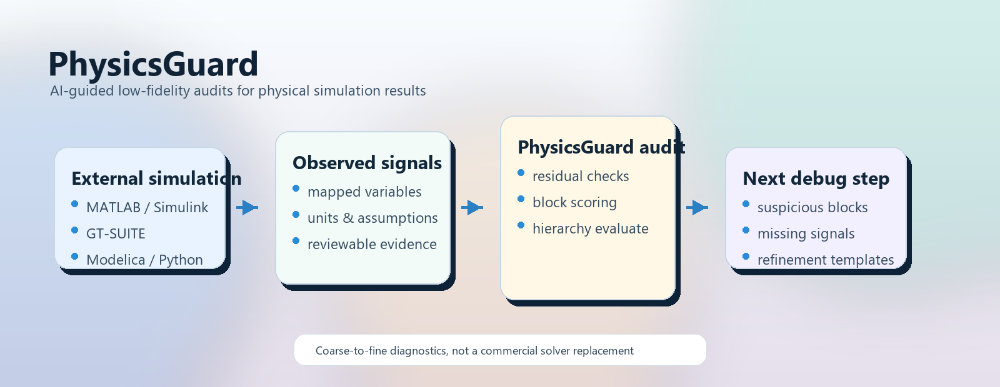

# PhysicsGuard

<!-- README HERO START -->
<p align="center">
  
</p>

<p align="center">
  <strong>Low-fidelity residual audits for mapped physical-simulation signals and AI debugging plans.</strong>
</p>
<!-- README HERO END -->

| Version | Runtime | Package | License |
| --- | --- | --- | --- |
| `v0.15.22` | Python 3.11+ | `physicsguard` | MIT |

English comes first. A Chinese mirror follows below.

## What PhysicsGuard Is

PhysicsGuard is a Python toolkit and agent skill set (Codex, Claude Code) for AI-guided debugging of physical simulation workflows.

It helps an agent build a low-fidelity physical understanding map before it tries to fix, explain, or generate anything. That map names the visible symptom, subsystem boundary, interfaces, SI units, conservation relations, mapped signals, assumptions, residual checks, and stop condition.

From that map, PhysicsGuard can evaluate observed or user-mapped values, rank suspicious blocks, expose assumptions, recommend the next signals or parameters to inspect, and produce a candidate-model audit for a separate user-owned model.

The task-local diagnostic route also preserves bounded measurement, mapping,
and model uncertainty as intervals. It reports robust pass/fail,
indeterminate, or not-run residual status, derives pairwise fault-signature
distinguishability, and recommends the next declared signal without claiming
the true physical fault.

It does not parse commercial solver formats, reverse engineer proprietary models, replace the original solver, or claim high-fidelity equivalence. The original engineering model remains the source of truth.

One reading is not adequate coverage for a time-varying parameter. Pointwise evaluation is not prediction: prediction needs state propagation and an exact, disjoint future holdout. Keep diagnostic hypotheses and revisions task-local; do not change PhysicsGuard thresholds, code, library defaults or installed skills. Use official, user-provided or documented tool interfaces, and stop at the audit when an interface is unavailable.

## The Problem

Large simulation models often fail in ways that are easy for an AI agent to misread:

1. A signal has the wrong sign.
2. A unit conversion is silently off.
3. A lookup map is outside its valid range.
4. A mass, energy, heat, torque, pressure, voltage, or signal balance no longer closes.
5. A mapped external signal is only a guess, but the agent treats it as verified.
6. The agent asks for every possible signal instead of the next signal that would actually reduce uncertainty.

PhysicsGuard turns those failures into a low-fidelity residual audit that an engineer can inspect.

## How It Works

The practical route is:

```text
visible symptom
-> subsystem boundary
-> mapped signals and units
-> low-fidelity residual hierarchy
-> suspicious blocks and assumptions
-> next-signal recommendations
-> optional candidate-model audit
```

The important design choice is modesty. PhysicsGuard does not try to recreate a full solver. It checks explicit, reviewable relations such as balances, gains, signs, map bounds, controller steps, flow splits, and sanity envelopes.

## What It Can Build And Check

| Goal | PhysicsGuard output | Boundary |
| --- | --- | --- |
| Understand a simulation failure | Level 0 physical map with symptom, subsystem, expected relation, key signals, SI units, assumptions, and first residuals | Low-fidelity understanding, not solver reconstruction |
| Localize a likely bug | Hierarchy report with suspicious blocks, top residuals, assumption cards, and recommended refinements | Ranking is diagnostic evidence, not proof of the only fault |
| Decide what to export next | Specific signal, parameter, unit, bound, map, or topology request | Missing data stays explicit |
| Validate mapped data files | One test-file contract, generated manifest, unit-aware snapshots and series | File coverage is not physical correctness |
| Compare model and dataset | Logical checks, relation checks, validation reports, and optional bounded calibration | Calibration is conservative and bounded |
| Build a candidate model | Interfaces, units, assumptions, block relations, examples, and validation order | Candidate models are new artifacts, not recovered commercial models |

## Quick Start

Install the package in editable mode:

```powershell
python -m pip install -e .
```

Install the skills for your agent (only the consumer files are copied):

```powershell
python scripts/install_physicsguard_skills.py --target ~/.codex/skills              # Codex
python scripts/install_physicsguard_skills.py --target ~/.claude/skills             # Claude Code
python scripts/install_physicsguard_skills.py --target ~/.claude/skills --check     # installed copy equals this checkout?
```

Run the public example:

```powershell
python -m physicsguard.cli hierarchy evaluate examples/hierarchical/observed_debugging/pitch_feedback_level_0.yaml examples/hierarchical/observed_debugging/pitch_feedback_observed_fault.yaml --pretty
```

The example represents a mapped controller feedback signal. The fault case has a reversed sign, so PhysicsGuard ranks `pitch_rate_feedback` as suspicious and recommends checking sign convention, gain, mapping confidence, unit conversion, and related signal-chain mappings.

`hierarchy run|evaluate|compare|variants` print the audit tree with each block's verdict (failing residuals, unchecked blocks, refinement checks, next signals); `validation run` prints a compact summary; add `--json` for the full report.

`stale_when` records when a signal mapping needs reconfirmation; only explicit `mapping_status: stale` marks it stale.

Discover relations and inspect a model before evaluating it:

```powershell
python -m physicsguard.cli modules list
python -m physicsguard.cli modules describe TankVolumeRateModule --pretty
python -m physicsguard.cli hierarchy describe examples/hierarchical/heated_tank/heated_tank.yaml
python -m physicsguard.cli hierarchy describe examples/hierarchical/heated_tank/heated_tank.yaml --observed examples/hierarchical/heated_tank/measured_k70.yaml
python -m physicsguard.cli hierarchy describe examples/hierarchical/heated_tank/heated_tank.yaml --json
python -m physicsguard.cli hierarchy describe examples/hierarchical/heated_tank/heated_tank.yaml --mermaid
```

Module descriptions expose units, finite variable bounds/scales, parameter names, residuals and validity metadata. Marked synthetic examples are not physical defaults or audit evidence. Hierarchy descriptions print one readable tree with components, connections, refinements, declared fault variants and rules. `--observed` counts mapped signals per block, `--json` retains the full structure, and `--mermaid` draws it; none solves or evaluates. See the installed skill's [model format and templates](skill/physicsguard/references/model-format.md). The tree names benign variants in its header and shows each assumption card on its block; `--observed` counts only declared needs (`declared needs missing`).

## Main CLI Paths

Exit codes: 0 passed, 1 checked and not passed, 2 could not run. Single-system files use `hierarchy run|evaluate|compare` and are read as a tree with one root block.

Project and model-understanding checks:

```powershell
python -m physicsguard.cli preflight review skill/physicsguard/references/templates/model_understanding_preflight.yaml --pretty
```

Model-derived fault signatures and next measurements:

```powershell
python -m physicsguard.cli hierarchy variants AUDIT.yaml NOMINAL.yaml --pairs --observed OBSERVED.yaml --json
```

Declare `fault_variants` in the audit to describe another device through parameter or measurement changes and selected values to rederive. PhysicsGuard evaluates the resulting data against the nominal model, preserves both inputs, groups identical fault signatures and recommends an unmeasured signal using scale-normalized differences. Detection is separate from proving the cause or distinguishing every fault; inspect `detected`, `neutral`, `expect_blocks_met`, `indistinguishable` and `matching_variants`.

Test-file and dataset checks:

With `testfile manifest --out`, the source path is relative to the manifest directory; stdout-only manifests keep the supplied source path.

```powershell
python -m physicsguard.cli testfile manifest DATA.csv --profile CONTRACT.yaml --out MANIFEST.yaml
python -m physicsguard.cli testfile contract-check CONTRACT.yaml --pretty
python -m physicsguard.cli testfile snapshot CONTRACT.yaml --row 70 --out measured.yaml
python -m physicsguard.cli testfile series CONTRACT.yaml --rows 0:120 --out series.yaml
python -m physicsguard.cli validation run VALIDATION_PLAN.yaml --pretty
```

The [heated-tank reference](examples/hierarchical/heated_tank/) includes a reproducible non-SI CSV, coarse and six-block coupled models, an explicit nameplate-efficiency assumption, and measured-only snapshots. `hierarchy evaluate` can propagate connected quantities and derive supported intermediate values from those measurements. It reports `derived_variables`, `checked_residuals` and `unchecked_residuals`; the tree's first line counts checked, unchecked and derived relations. Do not fill remaining gaps with initial guesses or hand-computed intermediate snapshots.

Connections mean the two endpoints are the same physical quantity. A known value can propagate to an unknown endpoint without overwriting measurements; conflicting measured endpoints remain a connection check. Their default residual scale is `1e-6` times the larger endpoint scale; an explicit positive finite connection `scale` can declare a small measurement tolerance. Use a relation module when the quantities may physically differ.

Intermediate derivation uses each residual's supported structural value/control dependencies. An unrelated missing channel does not suppress a fully measured aggregate balance or fixed-parameter map check. Only `equation`, `connection`, `boundary` and `assumption` relations with one unknown can supply a finite, bounded scalar root. Ambiguous, flat, undefined or unsupported cases remain unknown; this is not a global nonlinear uniqueness proof. Relations used to derive values never count as checks, scores or top residuals, and an evaluation with no remaining check is refused. Component order determines which eligible relation supplies a value: put measurement-to-internal relations first. Strict library evaluation checks for remaining missing values after derivation; the CLI skips and lists them. Observed values and conversion evidence are unchanged; `hierarchy run` and `hierarchy compare` retain their existing reference-solve boundaries. See the [hierarchy workflow](skill/physicsguard/references/model-format.md) for supported-source and ordering limits.

Parent blocks include failing descendants in `audit_pass`, while `own_audit_pass` and `score` retain their local meaning and `subtree_score` reports the subtree maximum. `refines` links a detail block to its parent's coarse components; refinement reports compare their checked relations and resolve each template id as `block`, `file` or `planned` without executing it.

## Assumption Cards

PhysicsGuard treats assumptions as first-class audit objects. Assumptions can be active, proposed, rejected, high-impact, or under review.

`assumptions inspect` accepts a single-system model or a hierarchical audit, inspecting the same cards from the wrapped system without solving.

This matters because an AI agent can otherwise hide a missing signal or parameter behind a plausible sentence. In PhysicsGuard, a missing coolant flow, uncertain gain, unverified unit, or proposed map simplification must remain visible until it is supported, rejected, or scoped out.

## Visual Audit Communication

PhysicsGuard can use compact diagrams and tables to explain:

- subsystem topology and interfaces;
- residual localization;
- observed signal mappings;
- active, proposed, and rejected assumptions;
- coarse-to-fine refinement paths;
- candidate-model audits.

Those visuals are explanation aids. Validation still comes from residual reports, explicit mappings, tests, and examples.

## When To Use It

Use PhysicsGuard when:

- an AI agent is debugging a physical simulation or controller-like workflow;
- the issue could involve units, signs, gains, maps, balances, or signal mappings;
- you need to decide which signal or parameter to export next;
- a low-fidelity candidate model would help explain or test the suspected subsystem;
- you need an audit record that keeps assumptions and missing evidence visible.

Do not use it when:

- the task only needs a full-fidelity solver run;
- you need proprietary model extraction;
- no physical boundary, signal, unit, or residual relation is available;
- a statistical or business claim is being evaluated rather than a physical relation.

## Library Coverage

PhysicsGuard includes low-fidelity audit relations for:

- controls, sensors, actuators, delays, saturation, maps, and PID-like steps;
- drivetrain, vehicle, brake, wheel, gearbox, and road-load relations;
- electric motor, inverter, DC/DC, battery, charger, and HV bus checks;
- fuel cell, electrolyzer, gas production, recirculation, cooling, and balance checks;
- engine, turbo, aftertreatment, thermal, humidifier, heat exchanger, radiator, and compressor sanity checks;
- fluid networks, pumps, valves, pressure drops, split/merge relations, and lumped volumes.

Each relation is low fidelity by design. The value is not that it replaces the simulation model; the value is that it gives the AI a checkable physics boundary before it changes the simulation workflow.

## Documentation Map

| File | Purpose |
| --- | --- |
| [`skill/physicsguard/references/routes/model-understanding-preflight.md`](./skill/physicsguard/references/routes/model-understanding-preflight.md) | visible symptom, physical boundary, units, assumptions and stop conditions |
| [`skill/physicsguard/references/routes/ai-debugging.md`](./skill/physicsguard/references/routes/ai-debugging.md) | residual localization and bounded competing-cause checks |
| [`skill/physicsguard/references/routes/signal-mapping-review.md`](./skill/physicsguard/references/routes/signal-mapping-review.md) | source signal, unit, conversion, confidence and review |
| [`skill/physicsguard/references/model-format.md`](./skill/physicsguard/references/model-format.md) | audit trees, observed snapshots, assumptions and model growth |
| [`skill/physicsguard/references/routes/test-file-contract-review.md`](./skill/physicsguard/references/routes/test-file-contract-review.md) | concrete test-file manifests and binding contracts |
| [`skill/physicsguard/references/routes/model-dataset-validation.md`](./skill/physicsguard/references/routes/model-dataset-validation.md) | dataset validation and bounded calibration |
| [`docs/module_spec_template.md`](./docs/module_spec_template.md) | developer guide for new physical relations |
| [`docs/assumption_cards.md`](./docs/assumption_cards.md) | assumption-card lifecycle |
| [`docs/domain_starter_packs.md`](./docs/domain_starter_packs.md) | domain starter-pack coverage |

## Repository Layout

```text
src/physicsguard/       Core package
examples/               Low-fidelity relation and conflict examples
docs/                   Developer guides (module spec, assumption cards, starter packs)
skill/                  agent skill material
scripts/                Validation and release checks
assets/readme-hero/     README hero image assets
VERSION                 Current public version
CHANGELOG.md            Release history
```

## Public Boundary

This public repository contains the low-fidelity audit framework, examples, docs, templates, and skill material.

It does not contain proprietary model files, customer simulation data, confidential signal exports, production calibration data, or recovered commercial-model internals. A PhysicsGuard pass means the declared low-fidelity checks passed for the mapped evidence. It does not mean the original engineering model is correct.

## License

MIT. See [`LICENSE`](./LICENSE).

---

# PhysicsGuard 中文说明

| 版本 | 运行环境 | 包名 | 许可证 |
| --- | --- | --- | --- |
| `v0.15.22` | Python 3.11+ | `physicsguard` | MIT |

## 它是什么

PhysicsGuard 是一个用于 AI 辅助物理仿真调试的 Python 工具包和 agent 技能（Codex、Claude Code）。

它让 agent 在修模型、解释问题或生成候选模型之前，先建立一个低保真的物理理解图：可见症状、子系统边界、接口、SI 单位、守恒关系、映射信号、假设、residual 检查和停止条件。

基于这个图，PhysicsGuard 可以代入 observed / user-mapped values，排序可疑 block，暴露假设，推荐下一步该检查的信号或参数，并产出一个独立候选模型的 audit。

它不解析商业 solver 格式，不逆向专有模型，不替代原始 solver，也不声称高保真等价。原始工程模型仍然是事实来源。

时变参数不能用一个值算作充分覆盖。逐点评估不等于预测，预测需要状态传播及精确、互不重叠的未来留出检验。诊断假设和修订只保存在当前任务中，不修改 PhysicsGuard 阈值、代码、库默认值或已安装技能。外部工具只使用官方、用户提供或有文档的接口；没有可用接口时止于审计。

## 为什么需要它

大型仿真模型常见错误很容易被 AI 误读：

1. 信号符号反了。
2. 单位转换悄悄错了。
3. lookup map 超出有效范围。
4. 质量、能量、热量、扭矩、压力、电压或信号 balance 不闭合。
5. 外部信号映射只是猜测，但 agent 当成 verified。
6. agent 要求导出所有信号，而不是问真正能减少不确定性的下一个信号。

PhysicsGuard 把这些问题变成工程师可以检查的低保真 residual audit。

## 它怎么工作

实际路线是：

```text
visible symptom
-> subsystem boundary
-> mapped signals and units
-> low-fidelity residual hierarchy
-> suspicious blocks and assumptions
-> next-signal recommendations
-> optional candidate-model audit
```

关键是克制。PhysicsGuard 不试图重建完整 solver，只检查明确、可审阅的关系，比如 balance、gain、sign、map bounds、controller step、flow split 和 sanity envelope。

## 它能搭出并检查什么

| 目标 | PhysicsGuard 产出 | 边界 |
| --- | --- | --- |
| 理解仿真故障 | Level 0 physical map | 低保真理解，不是 solver 重建 |
| 定位可能 bug | suspicious blocks、top residuals、assumption cards、refinements | 排名是诊断证据，不是唯一故障证明 |
| 决定下一步导出什么 | 有针对性的 signal / parameter / unit / map 请求 | 缺失数据保持显式 |
| 校验 mapped data files | manifest、contract、coverage、model binding | 文件覆盖不等于物理正确 |
| 对比模型和数据 | logical check、relation check、validation report、bounded calibration | calibration 是保守有界的 |
| 生成候选模型 | interface、unit、assumption、block relation、example、validation order | 候选模型是新工件，不是恢复商业模型 |

## 快速开始

以 editable 模式安装：

```powershell
python -m pip install -e .
```

为你的 agent 安装技能（只复制使用者需要的文件）：

```powershell
python scripts/install_physicsguard_skills.py --target ~/.codex/skills              # Codex
python scripts/install_physicsguard_skills.py --target ~/.claude/skills             # Claude Code
python scripts/install_physicsguard_skills.py --target ~/.claude/skills --check     # installed copy equals this checkout?
```

运行公开示例：

```powershell
python -m physicsguard.cli hierarchy evaluate examples/hierarchical/observed_debugging/pitch_feedback_level_0.yaml examples/hierarchical/observed_debugging/pitch_feedback_observed_fault.yaml --pretty
```

这个例子表示一个映射过的 controller feedback signal。故障 case 的符号反了，所以 PhysicsGuard 会把 `pitch_rate_feedback` 排为可疑项，并建议检查 sign convention、gain、mapping confidence、unit conversion 和相关 signal-chain mapping。

`hierarchy run|evaluate|compare|variants` 默认输出审计树，每个块带结论（失败残差、未检查的块、细化检查、下一步信号）；`validation run` 默认输出紧凑摘要；加 `--json` 输出完整报告。

`stale_when` 记录信号映射何时需要重新确认；只有显式 `mapping_status: stale` 才表示映射已经过期。

评估前先查真实关系并查看模型结构：

```powershell
python -m physicsguard.cli modules list
python -m physicsguard.cli modules describe TankVolumeRateModule --pretty
python -m physicsguard.cli hierarchy describe examples/hierarchical/heated_tank/heated_tank.yaml
python -m physicsguard.cli hierarchy describe examples/hierarchical/heated_tank/heated_tank.yaml --observed examples/hierarchical/heated_tank/measured_k70.yaml
python -m physicsguard.cli hierarchy describe examples/hierarchical/heated_tank/heated_tank.yaml --json
python -m physicsguard.cli hierarchy describe examples/hierarchical/heated_tank/heated_tank.yaml --mermaid
```

模块说明列出单位、变量的有限边界与尺度、参数名、残差及适用范围。标记为 synthetic 的示例不是物理默认值或审计证据。分层说明默认输出一页文字树，列出组件、连接、细化、针对各块的故障变体和规则；`--observed` 统计每块信号，`--json` 保留完整结构，`--mermaid` 画图，均不求解或评估。格式及可配套使用的模板见技能中的[模型格式页](skill/physicsguard/references/model-format.md)。树的页头点名良性变体，每张假设卡显示在它所在的块上；`--observed` 只数块声明的需要（`declared needs missing`）。

## 主要 CLI 路线

退出码：0 表示运行并通过，1 表示已检查但未通过，2 表示无法运行。 单系统文件使用 `hierarchy run|evaluate|compare`，并读取为只有一个根块的树。

项目和模型理解检查：

```powershell
python -m physicsguard.cli preflight review skill/physicsguard/references/templates/model_understanding_preflight.yaml --pretty
```

由模型生成故障特征和下一步测量：

```powershell
python -m physicsguard.cli hierarchy variants AUDIT.yaml NOMINAL.yaml --pairs --observed OBSERVED.yaml --json
```

在审计文件的 `fault_variants` 中用参数、测量改动及指定重新推导的值描述“另一台装置”。PhysicsGuard 用名义模型检查变体数据，保留原模型与观测，把相同故障特征分组，并按变量尺度归一化的差异推荐尚未测量的信号。检出不等于证明真实原因或区分全部故障；应读取 `detected`、`neutral`、`expect_blocks_met`、`indistinguishable` 和 `matching_variants`。

测试文件和数据集检查：

`testfile manifest --out` 把源文件路径写成相对清单目录的路径；只输出到屏幕时保留传入的源文件路径。

```powershell
python -m physicsguard.cli testfile manifest DATA.csv --profile CONTRACT.yaml --out MANIFEST.yaml
python -m physicsguard.cli testfile contract-check CONTRACT.yaml --pretty
python -m physicsguard.cli testfile snapshot CONTRACT.yaml --row 70 --out measured.yaml
python -m physicsguard.cli testfile series CONTRACT.yaml --rows 0:120 --out series.yaml
python -m physicsguard.cli validation run VALIDATION_PLAN.yaml --pretty
```

[加热水箱参考例子](examples/hierarchical/heated_tank/) 提供可重复生成的非 SI CSV、粗模型和六块耦合模型、明确的铭牌效率假设及仅含测量值的快照。`hierarchy evaluate` 可以传播相连的同一物理量，并从测量值推出受支持的中间量。报告区分 `derived_variables`、`checked_residuals` 和 `unchecked_residuals`，树的第一行给出已检查、未检查和推出的数量。剩余缺口不能用初值或手算中间量快照补成通过。

连接表示两端是同一个物理量，已知端可传播到未知端，但不会覆盖测量值；相互冲突的实测端点仍由连接残差检查。默认残差尺度为较大端点变量尺度的 `1e-6` 倍；可用正的有限连接 `scale` 声明较小的测量容差。两端可能真实不同，应使用显式关系模块。

中间量推导使用每条残差受支持的结构值依赖和控制依赖。无关通道缺测不会跳过自身测量齐备的总量平衡或固定参数表检查。只有 `equation`、`connection`、`boundary`、`assumption` 关系在恰有一个未知量时才能提供有限边界内的标量根；歧义、平坦、无定义或不支持的情形仍保持未知，不构成一般非线性唯一根证明。用于推出的关系永不计入检查、分数或最大残差，没有剩余检查时拒绝评估。组件顺序决定先使用哪条合格关系，应把测量值到内部量的关系放在前面。严格库入口在推导后判断剩余缺值，CLI 则跳过并列出；观测值和转换证据不变，`hierarchy run`、`hierarchy compare` 保留原有参考求解边界。支持范围和排序限制见[分层审计工作流](skill/physicsguard/references/model-format.md)。

父块的 `audit_pass` 包含后代失败；`own_audit_pass` 和 `score` 保留本块含义，`subtree_score` 给出子树最大分数。`refines` 将细块关联到父块自己的粗组件，报告用已检查关系比较粗细一致性，并逐个将模板引用解析为 `block`、`file` 或 `planned`，不会执行模板。

## 假设卡片

PhysicsGuard 把假设当成一等审计对象。假设可以是 active、proposed、rejected、high-impact 或 under review。

`assumptions inspect` 同时接受单系统模型和分层审计文件，从其中的 system 检查同一套假设卡片，不进行求解。

这很重要，因为 AI 容易用一句合理的话掩盖缺失信号或参数。在 PhysicsGuard 里，缺失 coolant flow、不确定 gain、未验证单位或 proposed map simplification 都必须保持可见，直到被支持、拒绝或明确排除。

## 可视化审计沟通

PhysicsGuard 可以用紧凑图表解释：

- subsystem topology 和 interface；
- residual localization；
- observed signal mapping；
- active / proposed / rejected assumptions；
- coarse-to-fine refinement path；
- candidate-model audit。

这些图是解释辅助。真正验证仍然来自 residual report、显式 mapping、tests 和 examples。

## 什么时候用

适合：

- AI agent 正在调试物理仿真或 controller-like workflow；
- 问题可能来自单位、符号、gain、map、balance 或 signal mapping；
- 需要决定下一步导出哪个信号或参数；
- 低保真候选模型能帮助解释或测试可疑子系统；
- 需要把假设和缺失证据保持可见的审计记录。

不适合：

- 只需要跑完整高保真 solver；
- 需要提取专有模型；
- 没有物理边界、信号、单位或 residual relation；
- 要评估的是统计或业务 claim，而不是物理关系。

## 模块覆盖

PhysicsGuard 包含这些低保真审计关系：

- controls、sensors、actuators、delays、saturation、maps、PID-like steps；
- drivetrain、vehicle、brake、wheel、gearbox、road-load；
- electric motor、inverter、DC/DC、battery、charger、HV bus；
- fuel cell、electrolyzer、gas production、recirculation、cooling、balance；
- engine、turbo、aftertreatment、thermal、humidifier、heat exchanger、radiator、compressor sanity；
- fluid networks、pumps、valves、pressure drops、split/merge、lumped volumes。

每个关系都是低保真的。价值不在于替代目标模型，而在于让 AI 在改目标 workflow 之前先有一个可检查的物理边界。

## 文档入口

| 文件 | 作用 |
| --- | --- |
| [`skill/physicsguard/references/routes/model-understanding-preflight.md`](./skill/physicsguard/references/routes/model-understanding-preflight.md) | 症状、物理边界、单位、假设和停止条件 |
| [`skill/physicsguard/references/routes/ai-debugging.md`](./skill/physicsguard/references/routes/ai-debugging.md) | 残差定位和有边界的竞争原因检查 |
| [`skill/physicsguard/references/routes/signal-mapping-review.md`](./skill/physicsguard/references/routes/signal-mapping-review.md) | 来源信号、单位、转换、置信度与复核 |
| [`skill/physicsguard/references/model-format.md`](./skill/physicsguard/references/model-format.md) | 审计树、观测快照、假设和模型生长 |
| [`skill/physicsguard/references/routes/test-file-contract-review.md`](./skill/physicsguard/references/routes/test-file-contract-review.md) | 测试文件 manifest 和 binding contract |
| [`skill/physicsguard/references/routes/model-dataset-validation.md`](./skill/physicsguard/references/routes/model-dataset-validation.md) | 数据集验证和有界 calibration |
| [`docs/module_spec_template.md`](./docs/module_spec_template.md) | 新物理关系的开发指南 |
| [`docs/assumption_cards.md`](./docs/assumption_cards.md) | 假设卡生命周期 |
| [`docs/domain_starter_packs.md`](./docs/domain_starter_packs.md) | 领域起步包覆盖 |

## 仓库结构

```text
src/physicsguard/       核心包
examples/               低保真关系和 conflict 示例
docs/                   开发指南（模块规格、假设卡、领域起步包）
skill/                  agent skill material
scripts/                验证和发布检查
assets/readme-hero/     README hero 素材
VERSION                 当前公开版本
CHANGELOG.md            发布历史
```

## 公开边界

这个公开仓库包含低保真审计框架、示例、文档、模板和 skill material。

它不包含专有模型文件、客户仿真数据、机密信号导出、生产 calibration 数据或恢复出来的商业模型内部结构。PhysicsGuard 通过，只表示声明的低保真检查在映射证据上通过，不表示原始工程模型正确。

## 许可证

MIT. See [`LICENSE`](./LICENSE).


For repository tests, install `.[test]`; this declares the current FlowGuard maintenance dependency. FlowGuard is optional for ordinary PhysicsGuard runtime use. The current repository map checks structure; selected native models and ordinary pytest verify behavior separately.

Install FlowGuard only from its owner’s GitHub repository (`git+https://github.com/liuyingxuvka/FlowGuard.git@<tag>`); the `flowguard` package on PyPI is a different project.

FlowGuard 只从主人的 GitHub 仓库安装（`git+https://github.com/liuyingxuvka/FlowGuard.git@<tag>`）；PyPI 上名为 `flowguard` 的包是另一个项目。
