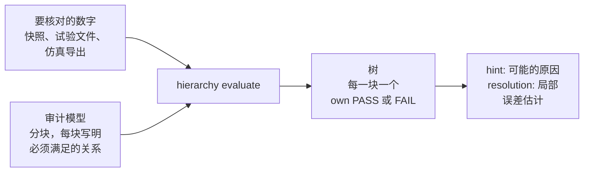

# PhysicsGuard

<p align="center">
  
</p>

<p align="center"><strong>AI 在脑子里算物理，单位、正负号、守恒算错了，还说得很肯定。PhysicsGuard 把这些数字放回它们必须满足的守恒关系里去核对，告诉你错在哪一块，以及这次检查能看见多小的误差。</strong></p>

| 版本 | 运行环境 | 包名 | 许可证 |
| --- | --- | --- | --- |
| `v0.16.0` | Python 3.11+ | `physicsguard` | MIT |

[English](./README.md)

PhysicsGuard 是一个 Python 工具，也是一个给 AI 用的技能（Claude Code、Codex）。它把一道计算题、一份仿真结果或一个试验数据文件，变成一份小小的审计：分成几块，每块写明必须满足的物理关系（质量守恒、能量守恒、单位换算、增益、查表），再填上要核对的数值。每条关系都由工具去算，不由 AI 去算；结果是每一块一个结论。

## 30 秒看懂：淋浴混水

用户问：*6 L/min 的水从 15 °C 加热到 60 °C，再和 9 L/min、15 °C 的冷水混合。加热器要多大功率？淋浴出水是多少度？*

**没有 PhysicsGuard**，AI 很有把握地回答：

> 加热功率：0.1 kg/s × 4186 J/(kg·K) × 45 K = **18,837 W**。
> 出水温度：(60 + 15) / 2 = **37.5 °C**。

功率算对了，温度错了：AI 把两个温度直接平均，忘了冷水流量更大。按能量守恒，应是 (0.1 × 60 + 0.15 × 15) / 0.25 = **33.0 °C**。

**有 PhysicsGuard**，AI 把自己的数字写进一份观测快照，拿一个两块的审计（串联加热器、混水三通）去核对。这两个文件都在仓库的 `examples/hierarchical/shower_mix/` 里：

```console
$ python -m physicsguard.cli hierarchy evaluate examples/hierarchical/shower_mix/audit.yaml examples/hierarchical/shower_mix/observed_ai.yaml
audit shower_mix on ai_answer: FAIL; 4 checked, 0 unchecked, 2 derived; mapping 8 rows, 0 with issues
supply [L0] | own PASS 0.00 (1 checked)
  hot_branch [L1] | own PASS 0.00 (1 checked)
  mixer [L1] | own FAIL 22.50 (2 checked): mix.flow_merge_temperature_balance 22.50
hint: conservation_balance mix.flow_merge_temperature_balance: Inspect sibling inflow/outflow, loss, storage, and boundary-condition variables before adding deeper component physics.
resolution: supply no observed variables
resolution: heater.m_dot_kg_s +-0.00053 kg/s, heater.T_in_K +-0.24 K, heater.T_out_K +-0.24 K, heater.Q_dot_W +-1e+02 W
resolution: mix.m_dot_2_kg_s +-0.00017 kg/s, mix.T_2_K +-0.33 K, mix.m_dot_out_kg_s +-0.00016 kg/s, mix.T_out_K +-0.2 K
warnings: observed audit did not pass; max observed normalized residual exceeds audit threshold; max observed normalized residual exceeds 10
```

加热器这一块通过，混水这一块不通过：它的能量平衡偏离了审计里写的容差的 22.5 倍，也就是差了 4.5 K，而审计只允许 0.2 K。`resolution:` 这一行给出这些数值处的局部一阶误差分辨率估计，解释“通过”时要一起看。把按流量加权算出的 33.0 °C（306.15 K）填进 `observed_ai.yaml` 的 `mix.T_out_K`，再跑一次同样的命令：

```console
$ python -m physicsguard.cli hierarchy evaluate examples/hierarchical/shower_mix/audit.yaml examples/hierarchical/shower_mix/observed_ai.yaml
audit shower_mix on ai_answer: PASS; 4 checked, 0 unchecked, 2 derived; mapping 8 rows, 0 with issues
supply [L0] | own PASS 0.00 (1 checked)
  hot_branch [L1] | own PASS 0.00 (1 checked)
  mixer [L1] | own PASS 0.00 (2 checked)
resolution: supply no observed variables
resolution: heater.m_dot_kg_s +-0.00053 kg/s, heater.T_in_K +-0.24 K, heater.T_out_K +-0.24 K, heater.Q_dot_W +-1e+02 W
resolution: mix.m_dot_2_kg_s +-0.00017 kg/s, mix.T_2_K +-0.33 K, mix.m_dot_out_kg_s +-0.00016 kg/s, mix.T_out_K +-0.2 K
```

退出码：0 通过，1 检查了但没通过，2 没法运行。

## 快速开始

**第一步：从发布的 tag 安装工具。**

```bash
python -m pip install "physicsguard @ git+https://github.com/liuyingxuvka/PhysicsGuard.git@v0.16.0"
```

**第二步：给你的 AI 装技能**，同样用这个 tag：

```bash
git clone --depth 1 --branch v0.16.0 https://github.com/liuyingxuvka/PhysicsGuard.git
python PhysicsGuard/scripts/install_physicsguard_skills.py --target ~/.claude/skills          # Claude Code
python PhysicsGuard/scripts/install_physicsguard_skills.py --target ~/.codex/skills           # Codex
python PhysicsGuard/scripts/install_physicsguard_skills.py --target ~/.claude/skills --check  # 装好的副本是不是最新的？
```

脚本把 `skill/physicsguard/`（其中的 `SKILL.md` 和 `agents/`、`references/`、`scripts/` 目录）复制到 `<target>/physicsguard/`，旧的副本会被替换。

**第三步：在克隆下来的目录里跑头三条命令：**

```bash
cd PhysicsGuard
python -m physicsguard.cli hierarchy describe examples/hierarchical/shower_mix/audit.yaml
python -m physicsguard.cli hierarchy evaluate examples/hierarchical/shower_mix/audit.yaml examples/hierarchical/shower_mix/observed_ai.yaml
python -m physicsguard.cli modules list --find mix
```

`hierarchy describe` 把审计按树读回来，什么都不计算；`hierarchy evaluate` 就是上面那次核对；`modules list --find` 帮你给自己的审计找关系模块（这里找到的是混水三通 `FlowMergeTemperatureModule`）。

### 核对你自己的一道计算

技能里有一条六步的快速路线（[`SKILL.md`](./skill/physicsguard/SKILL.md) 里的 `## Quick check of your own calculation`），大意是：

1. 照 [`audit_model.yaml`](./skill/physicsguard/references/templates/audit_model.yaml) 写一份粗的审计；用 `modules list --find <词>` 找模块，用 `modules describe TYPE` 看说明。独立检查要选原生、自含、声明了非空变量表的组件；只引用变量的平衡关系还需要拥有那些变量的组件。
2. 把给定输入按原始数值和单位写进快照，让工具去换算；AI 若还声称了换算后的输入值，也保留为 `value` 供读入时核对，声称的输出同样保留原始量。单位使用工具支持的名字，例如 `degC`。下面 L/min 到 kg/s 的显式系数假设水的密度为 1 kg/L：

   ```yaml
   variables:
     heater.T_in_K: {raw_value: 15, raw_unit: degC, unit: K}
     heater.m_dot_kg_s: {value: 0.1, raw_value: 6, raw_unit: L/min, unit: kg/s, conversion_factor: 0.0166667}
   ```

   没有声称换算后的值时，省略 `value`。如果某一行写的 `value` 和它的原始值、记下的换算系数对不上，命令以退出码 2 停下，并点名 `observed_value_disagrees_with_conversion:<变量>`。
3. 用 `hierarchy describe AUDIT --observed SNAPSHOT` 读回审计和映射，不求解。
4. 跑 `hierarchy evaluate AUDIT SNAPSHOT > check.txt`；退出 1 是检查不通过，也要保留输出。
5. 读这份保存的结果一次：`own FAIL`、`hint:` 行、局部 `resolution:` 估计和映射警告。
6. 只说输出撑得住的结论。

## 它是怎么工作的



每条关系都写成一个“残差”：物理关系成立时它等于零。审计给每个残差一个尺度，也就是你在它自己的单位上能容忍的误差；残差超过尺度就不通过。因为关系是按块放的，不通过时指向的是一个具体的地方（`mixer`），而不只是“答案不对”。能从已知数推出来的值会被推出来并计数，没法检查的关系会列成“未检查”，每个映射进来的数值都在映射账本里留一行（从哪里来、什么单位、怎么换算的）。

审计里还可以写上你想区分的几种典型错误。在淋浴的例子里，
`python -m physicsguard.cli hierarchy variants examples/hierarchical/shower_mix/audit.yaml examples/hierarchical/shower_mix/nominal.yaml`
会确认：“把温度直接平均”这个错在 `mixer` 这一块不通过，“忘了除以 60”这个错在 `hot_branch` 这一块不通过。

| 你手上有 | 用这些命令 |
| --- | --- |
| 一道计算或一份仿真结果 | `hierarchy describe`、`hierarchy evaluate`、`hierarchy compare`、`hierarchy run` |
| 几种要区分的错误，想知道下一个该测哪个信号 | `hierarchy variants AUDIT NOMINAL --pairs --observed OBSERVED` |
| 一个 CSV 或 TSV 试验数据文件 | `testfile manifest`、`testfile contract-check`、`testfile snapshot`、`testfile series`（合同里声明的单位由工具换算） |
| 一个要和数据集对比的模型 | `validation run` |
| 审计背后的假设 | `assumptions inspect` |
| 一个还没理清楚的问题 | `preflight review` |

命令的写法是 `python -m physicsguard.cli <命令> <子命令>`。分层审计命令和 `validation run` 支持加 `--json` 得到完整报告。

<!-- BEGIN GUARD FAMILY TABLE -->
## Guard 技能家族

五个技能，同一个思路：把结构、关系和约束写成一份单独、可检查的模型；让工具对照模型核对 AI 的答案或改动，给出反例，接过 AI 容易出错的那一步。每个技能都可以单独用。技能之间唯一的数据交接，是 LogicWriting 读取 ResearchGuard 和 WorldGuard 存下的报告。

| 技能 | 它弥补 AI 的哪个弱点 | 什么时候用 | 和其他技能怎么配合 |
|---|---|---|---|
| [FlowGuard](https://github.com/liuyingxuvka/FlowGuard) | 改了软件的一处，看不到别处因此坏了；把已经有的东西再写一遍，或者把新代码放错地方 | 修改、扩展、重构或审查软件代码，包括仿真程序本身的代码 | 计算结果交给 PhysicsGuard，因果结论交给 ResearchGuard，故事或计划的前后一致交给 WorldGuard，长文交给 LogicWriting。另外四个 Guard 自己也是用 FlowGuard 开发的 |
| [PhysicsGuard](https://github.com/liuyingxuvka/PhysicsGuard) | 在脑子里算物理，单位、正负号、守恒算错了还说得很肯定 | 数字来自物理：仿真结果、试验数据，或者 AI 自己算的一道题 | 仿真程序的代码交给 FlowGuard。没有别的技能读它的报告 |
| [ResearchGuard](https://github.com/liuyingxuvka/ResearchGuard) | 讲出一个很有把握的因果故事，资料其实撑不住 | 说出一个因果或证据上的结论之前：论点、来源、时间线、几种互相竞争的解释 | LogicWriting 读取它存下的状态报告。把结论写成完整的报告，交给 LogicWriting |
| [WorldGuard](https://github.com/liuyingxuvka/WorldGuard) | 跨章节、跨天、跨步骤时，忘了谁手里有什么、谁在哪里，写出不可能发生的事 | 一个故事、行程、计划或流程，要每一步都前后一致 | LogicWriting 读取它存下的检查报告。软件代码交给 FlowGuard |
| [LogicWriting](https://github.com/liuyingxuvka/LogicWriting) | 长文写着写着，偏离了自己的提纲和证据 | 要一篇给真实读者看的成品：调查报告、论文、小说或故事提纲、旅行攻略 | 读取 ResearchGuard 和 WorldGuard 存下的报告。只检查论点、不写成文，交给 ResearchGuard |
<!-- END GUARD FAMILY TABLE -->

## 实话实说：它的局限

**它不做什么。**
- 它故意做成低保真。它只检查审计里写下的关系，别的一概不管。通过，只说明这些检查对这些数值通过了；不说明工程模型、或者答案的其他部分都是对的。
- 它不代替求解器，不读商业软件的模型格式，也不还原专有模型。
- 把某一块排为“可疑”是证据，不是“唯一真正的错误”的证明。

**它仍然可能漏掉的地方。** 下面是上一个版本 `v0.15.25` 在淋浴例子上的真实输出：
- 检查有多细，取决于残差的尺度。用模块默认的尺度、流量减半时，同样 4.5 K 的错误会通过（`mixer [L1] | own PASS 0.56`）。从 `v0.16.0` 起，`resolution:` 行会写出每项检查的局部一阶误差分辨率估计，用的是默认尺度时标上 `(default scale)`；它不改变结论，所以说一个数“检查过了”之前，先看这一行。
- 如果 AI 自己换算单位，并把错误一路带下去（把 6 L/min 写成 6 kg/s），所有守恒都闭合，审计照样通过。从 `v0.16.0` 起，可以写 `raw_value` 和 `raw_unit`，让工具去换算；写的值和原始值对不上，命令就停下。AI 手算换好的数，仍然是 AI 的数。


**量过什么，没量过什么。**
- 量过：设计这个版本时，在上面的淋浴例子上做过一次小试验。PhysicsGuard 在正确的那一块抓住了“温度直接平均”这个错，并把它对上了审计里声明的那种错误；它漏掉了上面说的两种情况，这正是这个版本加上 `resolution:` 行和原始值的原因。
- 设计记录提到，第一次检查前要读约 21,800 个字符。六步快速路线就是为了缩短这段阅读路径；它的 token 成本还没有量过。
- 没量过：AI 自己算题时会不会主动想到 PhysicsGuard（技能的描述现在会提醒它）；在大型真实仿真上表现如何。

## 开发 PhysicsGuard

要跑仓库自己的测试，装 `test` 这一组依赖（`python -m pip install -e ".[test]"`）。它会装上 pytest 和 FlowGuard，PhysicsGuard 用 FlowGuard 维护自己；FlowGuard 只从它的 git tag 安装（`git+https://github.com/liuyingxuvka/FlowGuard.git@<tag>`），因为 PyPI 上同名的包是另一个项目。平常使用 PhysicsGuard 不需要 FlowGuard。

## 链接

- 技能本身：[`SKILL.md`](./skill/physicsguard/SKILL.md) 和它的参考文档：[模型格式](./skill/physicsguard/references/model-format.md)、[AI 调试](./skill/physicsguard/references/routes/ai-debugging.md)、[信号映射审查](./skill/physicsguard/references/routes/signal-mapping-review.md)、[试验文件合同](./skill/physicsguard/references/routes/test-file-contract-review.md)、[模型和数据集对比](./skill/physicsguard/references/routes/model-dataset-validation.md)、[建模前的理解检查](./skill/physicsguard/references/routes/model-understanding-preflight.md)（都是英文）
- 开发者指南：[新的关系模块](./docs/module_spec_template.md)、[假设卡片](./docs/assumption_cards.md)、[各领域入门包](./docs/domain_starter_packs.md)
- [更新记录](./CHANGELOG.md)
- 许可证：[MIT](./LICENSE)
